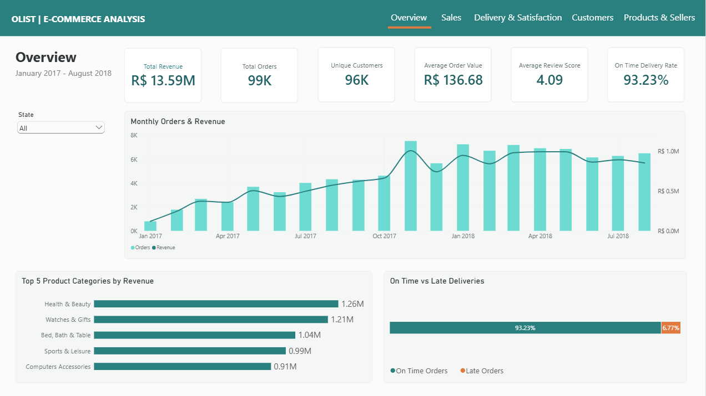
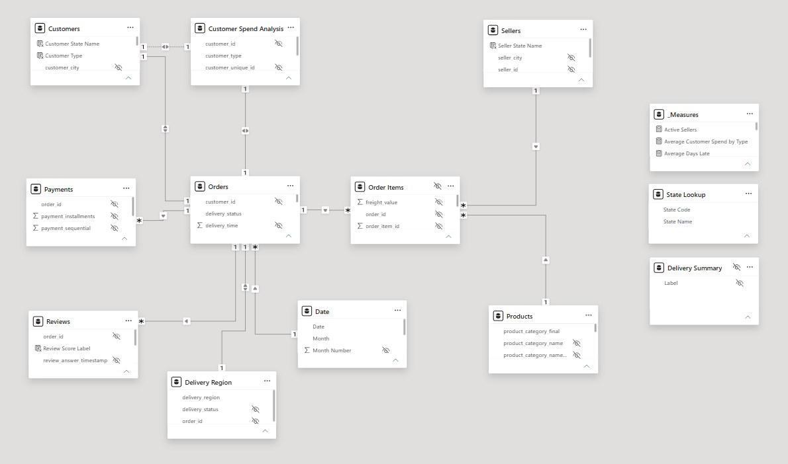
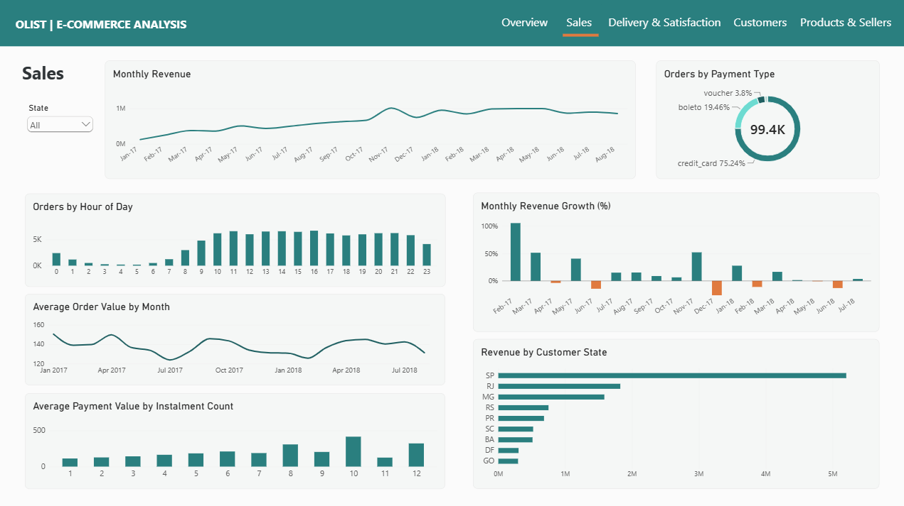
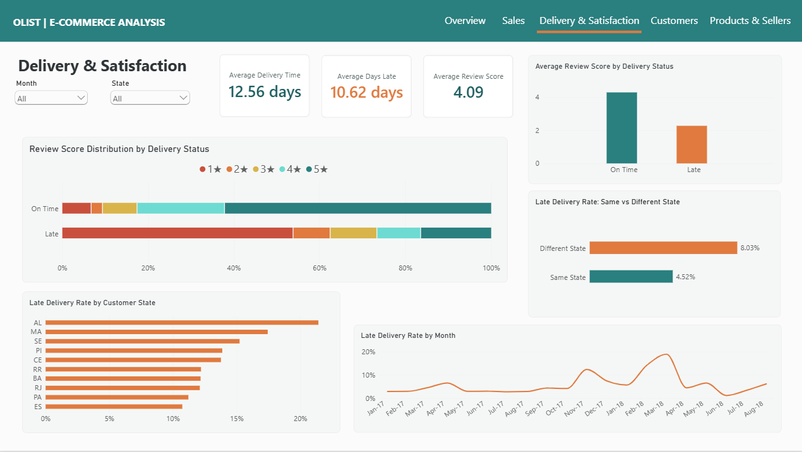
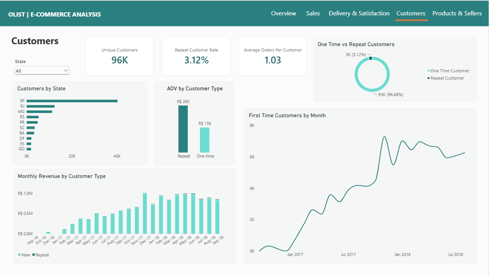
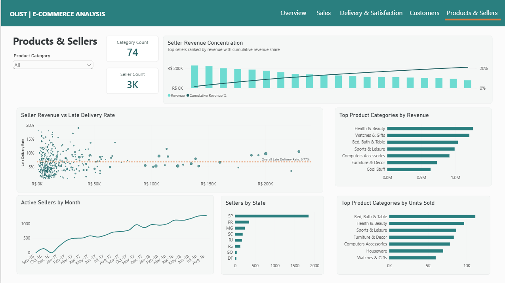

# Olist E-Commerce Analysis

End-to-end e-commerce analysis using PostgreSQL, SQL and Power BI.

## Project Overview

This project analyses the **Olist Brazilian E-Commerce dataset** using **PostgreSQL and Power BI**.

The aim was to build an end-to-end analytics project covering data validation, cleaning, business analysis, data modelling, DAX and dashboard design.

The analysis focuses on five areas:

- Overall marketplace performance
- Sales and payment behaviour
- Delivery performance and customer satisfaction
- Customer behaviour and retention
- Product and seller performance

The final output is an interactive **five-page Power BI dashboard** supported by reusable SQL views and a structured data model.

## Dashboard Preview



---

## Tools Used

- **PostgreSQL** — data storage, validation, cleaning and analysis
- **DBeaver** — SQL development
- **Power BI** — data modelling, DAX and dashboard development
- **GitHub** — project documentation and version control

---

## Dataset

The project uses the **Olist Brazilian E-Commerce Public Dataset**, which contains marketplace transactions from multiple interconnected tables.

**Data source:** [Olist — Brazilian E-Commerce Public Dataset, Kaggle](https://www.kaggle.com/datasets/olistbr/brazilian-ecommerce)  
**Period covered:** 2016–2018  
**Licence:** CC BY-NC-SA 4.0

The main tables used were:

- Customers
- Orders
- Order Items
- Payments
- Products
- Sellers
- Reviews
- Geolocation
- Product Category Translation

The dataset contains approximately **100,000 orders** and includes information about products, customers, sellers, payments, delivery performance and reviews.

---

## Project Workflow

The project followed a structured analytics workflow.

### 1. Data Validation

Initial SQL checks were performed to understand the structure and quality of the dataset.

This included:

- Row counts
- Primary key uniqueness
- Duplicate checks
- NULL checks
- Relationship validation
- Missing order items and payments
- Review coverage
- Category mapping validation

Examples of validation findings included:

- 99,441 orders
- 99,441 customer records
- 112,650 order-item records
- 103,886 payment records
- 32,951 products
- 3,095 sellers

---

### 2. Data Cleaning

Reusable PostgreSQL views were created to prepare the data for analysis and Power BI.

Cleaning included:

- Standardising product category names
- Translating product categories into English
- Handling unmapped categories
- Creating delivery-status classifications
- Calculating delivery times
- Creating cleaned order-item and payment views
- Preparing customer, seller and product analysis fields

Where possible, transformations were kept in SQL so that Power BI received clean and analysis-ready data.

---

## SQL Analysis

SQL was used to answer business questions across sales, customers, delivery, products and sellers.

Techniques used included:

- `JOIN`
- `CASE`
- `GROUP BY`
- Conditional aggregation
- Common Table Expressions
- Subqueries
- Window functions
- Ranking
- Cumulative totals
- Percentage calculations
- Reusable SQL views

---

## Power BI Data Model

The Power BI model connects the main transaction tables through orders, products, sellers and customers.

A dedicated **Date table** is used for time intelligence and chronological sorting.

The model uses primarily single-direction relationships to avoid ambiguous filtering.

Where a standard relationship direction could not support a required calculation, purpose-specific DAX measures were used rather than making relationships unnecessarily bidirectional.

Examples include seller delivery measures using filter context from order items.

Measures are organised in a dedicated `_Measures` table with folders for:

- Overview
- Sales
- Delivery
- Customers
- Products & Sellers

Technical keys and helper columns are hidden from report view to keep the model easier to navigate.

## Data Model 


---

# Dashboard

The final report contains five pages.

## 1. Overview

Provides a high-level summary of marketplace performance.

Key KPIs include:

- **Total Revenue:** approximately R$13.59M
- **Total Orders:** 99K
- **Unique Customers:** approximately 96K
- **Average Order Value:** R$136.68
- **Average Review Score:** 4.09
- **On-Time Delivery Rate:** 93.23%

Main visuals include:

- Monthly Orders & Revenue
- Top Product Categories by Revenue
- On-Time vs Late Deliveries

---

## 2. Sales

Explores revenue trends, order behaviour and payment patterns.



Analysis includes:

- Monthly revenue
- Month-over-month revenue growth
- Average order value by month
- Orders by hour of day
- Payment method usage
- Payment value by instalment count
- Revenue by customer state

One notable period was **November 2017**, when revenue increased by approximately **52% month-over-month**.

Average order value remained relatively stable, suggesting the increase was primarily driven by higher order volume.

---

## 3. Delivery & Satisfaction

Examines delivery reliability and its relationship with customer review scores.



Key findings include:

- **On-time delivery rate:** 93.23%
- **Average delivery time:** approximately 12.56 days
- **Average days late for late orders:** approximately 10.62 days
- **Average review score:** 4.09

Late deliveries were strongly associated with lower customer satisfaction:

- On-time orders averaged approximately **4.29 stars**
- Late orders averaged approximately **2.27 stars**

The review distribution also shows that late deliveries receive a much higher proportion of 1-star reviews.

### Same-State vs Cross-State Deliveries

Orders where sellers and customers were located in different states showed a noticeably higher late-delivery rate:

- **Same State:** 4.52%
- **Different State:** 8.03%

Cross-state deliveries therefore had roughly **1.8× the late-delivery rate** of same-state deliveries.

This suggests fulfilment distance is associated with increased delivery risk.

---

## 4. Customers

Explores customer acquisition, repeat behaviour and customer value.



Analysis includes:

- Unique customers
- Repeat customer rate
- Average orders per customer
- One-time vs repeat customer mix
- New customers by month
- Monthly revenue from new vs repeat customers
- Customers by state
- Average spend by customer type

The dataset is dominated by one-time customers, indicating limited repeat purchasing during the observed period.

However, repeat customers show significantly higher average spend.

Delivered-order customer analysis found approximately:

- **One-time customer average spend:** R$138
- **Repeat customer average spend:** R$260

This suggests that although repeat customers represent a relatively small part of the customer base, they are substantially more valuable on a per-customer basis.

---

## 5. Products & Sellers

Analyses product-category performance, marketplace seller growth and seller concentration.



Analysis includes:

- Product category count
- Seller count
- Active sellers by month
- Top product categories by revenue
- Top product categories by units sold
- Sellers by state
- Seller revenue vs late-delivery rate
- Seller revenue concentration

The highest-revenue product categories include:

1. Health & Beauty
2. Watches & Gifts
3. Bed Bath & Table
4. Sports & Leisure
5. Computers & Accessories

The top five categories account for approximately **40% of total product revenue**.

Seller revenue is also highly concentrated.

Approximately **18% of sellers generate 80% of marketplace revenue**, indicating that a relatively small proportion of sellers contribute the majority of sales.

---

# Key Business Insights

### Delivery performance is closely linked to customer satisfaction

On-time orders received an average review score of approximately **4.29**, compared with **2.27** for late deliveries.

Late orders also received a much higher proportion of 1-star reviews, showing a strong association between delivery reliability and customer satisfaction.

### Cross-state deliveries carry greater delivery risk

Deliveries involving sellers and customers in different states had a late-delivery rate of **8.03%**, compared with **4.52%** for same-state deliveries.

This suggests that cross-state fulfilment is associated with a greater risk of delay.

### Repeat customers are uncommon but more valuable

Most customers purchased only once during the period covered by the dataset.

However, repeat customers generated substantially higher average spend:

- **One-time customers:** approximately R$138
- **Repeat customers:** approximately R$260

Although repeat customers represent a relatively small part of the customer base, they are considerably more valuable on a per-customer basis.

### Revenue is concentrated across sellers and product categories

Approximately **18% of sellers generate 80% of marketplace revenue**, highlighting the importance of a relatively small group of high-value sellers.

Product revenue is also concentrated, with the five highest-revenue categories accounting for approximately **40% of total product revenue**.

### São Paulo is the marketplace's largest geographic market

São Paulo contributes the highest share of customer revenue and has the largest concentration of sellers, making it the most significant state within the marketplace.

---

# Business Recommendations

### Prioritise cross-state delivery performance

Investigate the routes, states and sellers contributing most to cross-state delivery delays.

These orders could be monitored more closely because they show a materially higher late-delivery rate than same-state orders.

### Focus on converting first-time customers into repeat customers

Repeat customers are relatively rare but generate much higher spend per customer.

Retention initiatives such as post-purchase offers, personalised recommendations or targeted re-engagement campaigns could be tested to improve second-order conversion.

### Monitor high-value sellers for both revenue and service quality

Because marketplace revenue is concentrated among a relatively small proportion of sellers, high-revenue sellers should be monitored not only for sales performance but also for delivery reliability and customer experience.

### Treat delivery reliability as a customer-experience KPI

The strong association between late deliveries and poorer review scores suggests that delivery performance should be monitored alongside customer satisfaction rather than treated purely as an operational metric.

### Monitor concentration risk

Dependence on a relatively small number of sellers and leading product categories should be tracked over time.

This can help identify potential marketplace dependencies and areas where greater diversification may be beneficial.

---

# Dashboard Design

The report uses a consistent **teal and orange** visual theme.

Core colours:

- Primary Teal: `#2A7F7F`
- Dark Teal: `#1F5F61`
- Light Teal: `#8FC8C3`
- Orange: `#E07A3F`
- Charcoal: `#2F3437`
- Muted Grey-Teal: `#5F6F6D`
- Page Background: `#F5F7F6`

Orange is reserved primarily for negative or warning states such as late deliveries and negative revenue growth.

---

# Repository Structure

```text
olist-ecommerce-analysis/
│
├── README.md
│
├── dashboard/
│   ├── Olist_Ecommerce_Analysis.pbix
│   └── screenshots/
│       ├── overview.png
│       ├── sales.png
│       ├── delivery_satisfaction.png
│       ├── customers.png
│       └── products_sellers.png
│
├── sql/
│   ├── 01_data_validation.sql
│   ├── 02_data_cleaning.sql
│   ├── 03_business_analysis.sql
│   └── 04_power_bi_views.sql
│
└── docs/
    └── data_model.png
```

---

# Skills Demonstrated

## SQL

- Data validation
- Data cleaning
- Multi-table joins
- CTEs
- Subqueries
- Conditional aggregation
- Window functions
- Ranking and cumulative calculations
- NULL handling
- Reusable views
- Business-focused analysis

## Power BI

- Data modelling
- Relationship management
- Filter context
- DAX measures
- Time intelligence
- Dynamic slicer-aware calculations
- KPI development
- Dashboard design
- Conditional formatting
- Business storytelling

---

# Limitations

The analysis should be interpreted within the boundaries of the dataset.

In particular:

- Customer behaviour represents activity only during the period covered by the dataset and should not be interpreted as lifetime retention.
- Relationships between delivery performance and review scores show association rather than proving causation.
- Some final months contain partial data and were excluded from visuals where they could distort trend interpretation.
- Revenue analysis primarily uses product price and does not represent marketplace profit.

---

# Conclusion

This project demonstrates an end-to-end analytics workflow, from validating and cleaning raw relational data in PostgreSQL through to developing an interactive Power BI reporting solution.

The analysis identified several important marketplace patterns, including the relationship between delivery performance and customer satisfaction, increased delivery risk for cross-state orders, the higher value of repeat customers, and substantial revenue concentration among sellers and product categories.

The final dashboard brings these findings together into an interactive reporting tool designed to support further investigation of marketplace performance, customer behaviour and operational risk.
